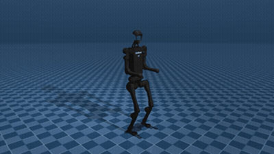
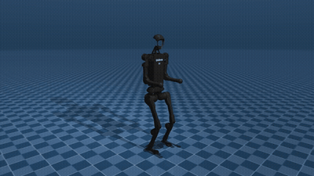
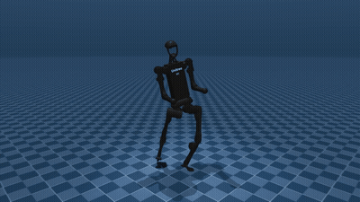
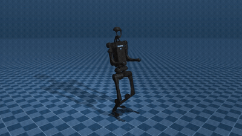
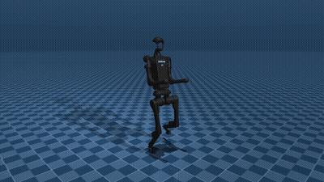
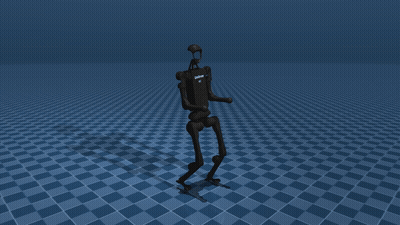
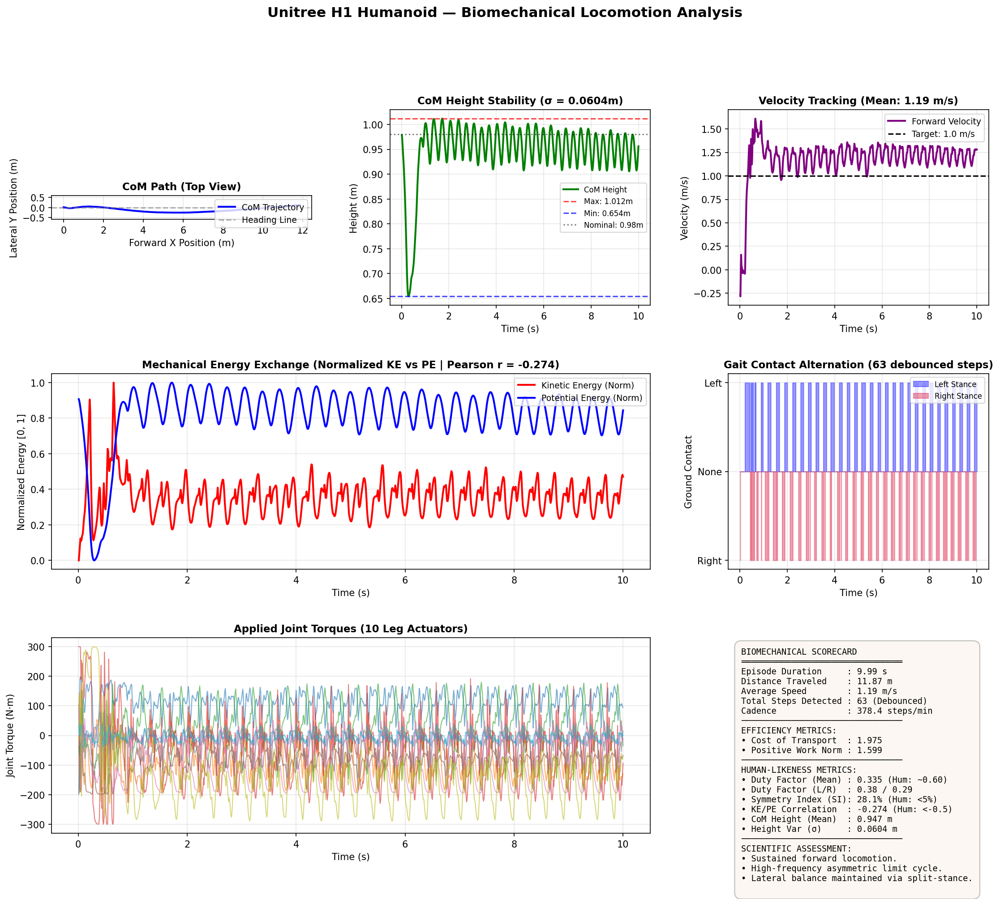
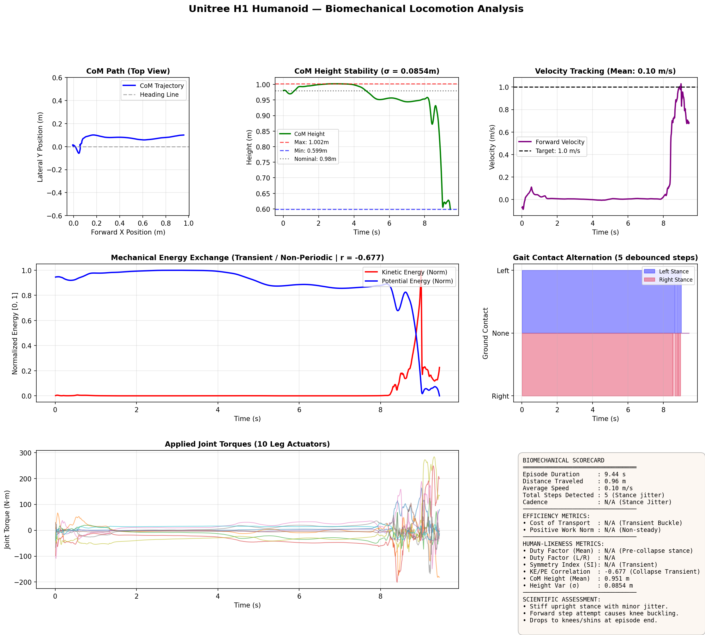
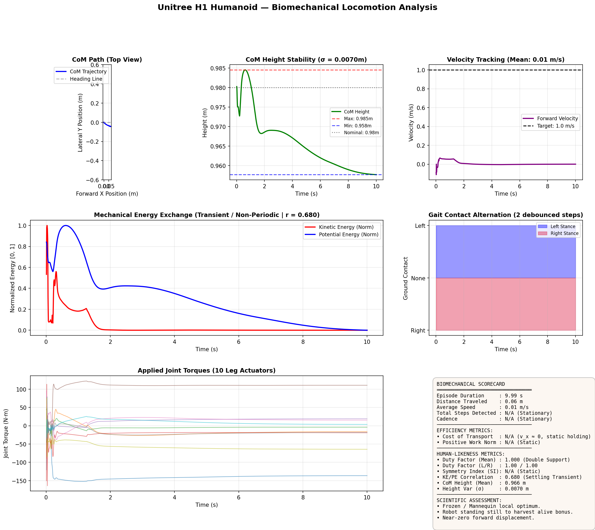
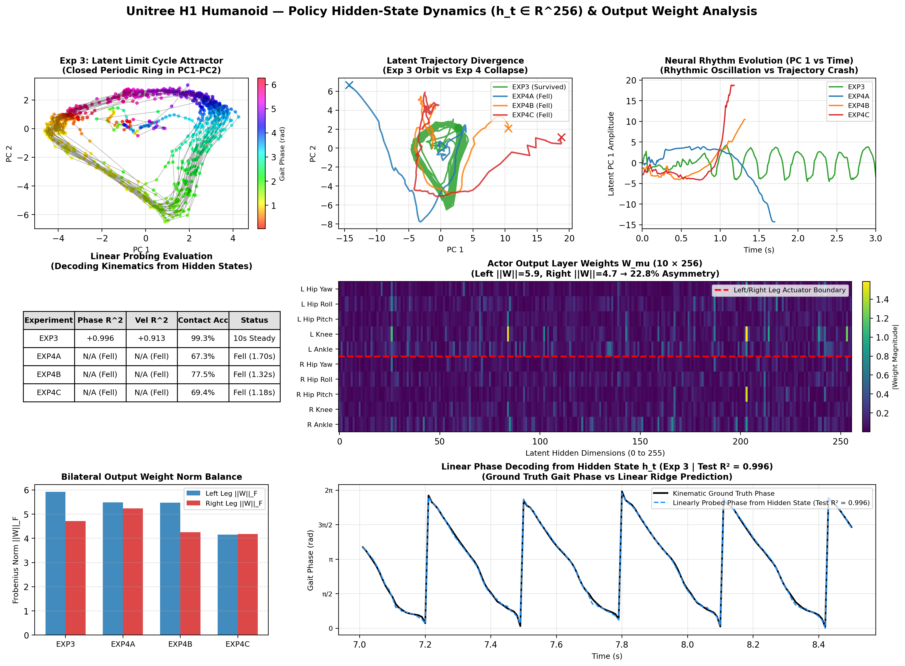

# Unitree H1 Locomotion: Minimal Rewards and Simulator Exploits in MuJoCo

Experiments evaluating continuous control and reward shaping for the 19-DOF Unitree H1 humanoid in MuJoCo using Soft Actor-Critic (SAC).

---

## 1. Overview

Most reinforcement learning controllers for 3D humanoid locomotion rely on reference motion capture data (DeepMimic, AMP), explicit periodic phase clocks, or massive domain randomization across parallel GPU environments.

This project tests whether an underactuated full-scale biped can learn forward walking from scratch using only velocity tracking and basic biomechanical penalties (Cost of Transport, bilateral symmetry, and swing clearance), without reference motions or clock inputs. All policies were trained locally on an NVIDIA RTX 4060 GPU using Stable-Baselines3 and MuJoCo.

Across six reward configurations, the agent converged to simulator exploits rather than human-like walking:
- Standing motionless to collect survival rewards indefinitely.
- Sliding in an asymmetric, split-stance "scooter" lunge to maintain a wide support polygon.
- Rapid forward pitch collapse (1.3 to 1.7 seconds) whenever penalties forced foot clearance or bilateral leg alternation without an active whole-body balance controller.

Despite the physical asymmetry, latent state analysis reveals that the feedforward policy spontaneously organizes its hidden layers into a periodic limit cycle (R² = 0.996 linear phase decoding), indicating that internal rhythm generation emerges well before physical balance is achieved.

---

## 2. Environment and Control Architecture (`envs/unitree_h1_env.py`)

- **Robot Model:** Unitree H1 (47 kg, 19 total DOFs, nominal standing CoM height 0.98 m) simulated in MuJoCo at 500 Hz (dt = 0.002 s).
- **Decoupled Control Architecture:** To reduce the exploration space for single-GPU training, upper and lower body actuation are separated:
  - **Upper Body (9 DOFs, Torso & Arms):** Stabilized by a proportional-derivative (PD) posture controller ($K_p = 100.0\text{ N}\cdot\text{m/rad}, K_d = 5.0\text{ N}\cdot\text{m}\cdot\text{s/rad}$) holding the torso upright and arms neutral.
  - **Lower Body (10 DOFs, Hips, Knees, Ankles):** Controlled by a Soft Actor-Critic policy at 100 Hz (substeps = 5). Joint torque limits follow `h1.xml`: $\pm 200\text{ N}\cdot\text{m}$ for hips, $\pm 300\text{ N}\cdot\text{m}$ for knees, and $\pm 40\text{ N}\cdot\text{m}$ for ankles.
- **Observation Space ($\mathbb{R}^{40}$):** Projected gravity vector (3D), base linear velocity (3D), base angular velocity (3D), target speed command (1D), leg joint positions (10D), leg joint velocities (10D), and previous actions (10D).

---

## 3. Experiments & Video Rollouts

Summary of reward configurations and emergent behaviors across the six ablation runs:

| Exp | Reward Configuration | Emergent Behavior in MuJoCo | Rollout Video | Outcome |
| :--- | :--- | :--- | :---: | :--- |
| **Exp 1** | **Naive Velocity**<br>(Unconstrained torque) | Stands stiffly with minor jitter ($\pm 50\text{ N}\cdot\text{m}$); knee buckles onto the floor at 5s when attempting to lean forward. | [▶ Watch](videos/exp1_naive.mp4) | Drops to knees at ~5s |
| **Exp 2** | **+ Effort & Posture**<br>(With +0.5/step survival bonus) | Stance freeze: settles 2.7 cm into a crouch and remains motionless (~0.01 m/s) to collect the survival bonus. | [▶ Watch](videos/exp2_posture.mp4) | Stands frozen for full 10s |
| **Exp 3** | **Zero Survival Bonus**<br>(Velocity + Effort + Smoothness) | Split-stance "scooter" exploit: left leg holds a forward flexed posture while trailing right leg pushes in a 3.3 Hz cycle. | [▶ Watch](videos/exp3_effort.mp4) | Sustained 11.87 m run over 10s |
| **Exp 4A** | **Exp 3 + Bilateral Symmetry** | Penalizing asymmetric effort breaks the split-stance tripod; torso leans back at 0s and pitches forward into a stumble at 1.7s. | [▶ Watch](videos/exp4a_symmetry.mp4) | Falls at 1.73s |
| **Exp 4B** | **Exp 3 + Swing Clearance** | Rewarding vertical foot lift forces single-leg support without active roll/pitch balance, causing backward fall. | [▶ Watch](videos/exp4b_clearance.mp4) | Falls at 1.35s |
| **Exp 4C** | **Exp 3 + Contact Alternation** | Forcing alternating steps causes rapid forward leg thrust and an unrecoverable trunk pitch faceplant. | [▶ Watch](videos/exp4c_alternation.mp4) | Falls at 1.36s |

### Visual Rollout Previews

| Exp 1: Stiff Stance & Kneeling Drop | Exp 2: Survival Bonus Exploit | Exp 3: Split-Stance Scooter Gait |
| :---: | :---: | :---: |
| <br>[▶ Full 60fps MP4](videos/exp1_naive.mp4) | <br>[▶ Full 60fps MP4](videos/exp2_posture.mp4) | <br>[▶ Full 60fps MP4](videos/exp3_effort.mp4) |
| *Stiff standing, knee buckle at 5s* | *Stands still to farm +0.5 bonus* | *3.3 Hz split-stance lunge (10s)* |

| Exp 4A: Bilateral Symmetry | Exp 4B: Swing Foot Clearance | Exp 4C: Contact Alternation |
| :---: | :---: | :---: |
| <br>[▶ Full 60fps MP4](videos/exp4a_symmetry.mp4) | <br>[▶ Full 60fps MP4](videos/exp4b_clearance.mp4) | <br>[▶ Full 60fps MP4](videos/exp4c_alternation.mp4) |
| *Torso pitch & forward stumble* | *Backward recline and fall* | *Rapid step shuffle & faceplant* |

---

### Benchmark Telemetry: Exp 3 Split-Stance Gait

Biomechanical telemetry for the sustained 10-second Exp 3 rollout:



- **Trajectory and Velocity Tracking:** CoM path tracking exhibits $<0.25\text{ m}$ lateral deviation over an $11.87\text{ m}$ run, maintaining mean CoM height at $0.947\text{ m}$ (following an initial $0.654\text{ m}$ crouch) with an average speed of $1.19\text{ m/s}$ (target: $1.0\text{ m/s}$).
- **Energy Exchange and Ground Contacts:** Normalized kinetic/potential energy correlation ($r = -0.274$) reflects sliding mechanics rather than classical inverted pendulum walking ($r < -0.50$). Stance duty factor is $0.335$ (left: $0.38$, right: $0.29$) with a bilateral symmetry index of $28.1\%$. The kinematic cycle runs at $\approx 3.3\text{ Hz}$ (63 debounced steps using a 4-step dwell filter), while raw foot scraping triggers 89 contact transitions ($534.5\text{ steps/min} \approx 8.9\text{ Hz}$).
- **Torque and Work:** Peak torques settle into a periodic $\pm 200\text{ N}\cdot\text{m}$ envelope after initial contact, yielding a Mechanical Cost of Transport ($\text{CoT}$) of $1.975$.

<details>
<summary><b>Exp 1 and Exp 2 Biomechanical Plots & Telemetry Notes</b></summary>

#### Exp 1: Naive Velocity Tracking (Stiff Stand & Kneeling Drop)

*Telemetry Note:* The robot remains stationary with low joint torques ($\pm 50\text{ N}\cdot\text{m}$) for the first 8s before attempting a forward step, causing the knees to buckle onto the floor (`CoM = 0.60 m`) and torque saturation ($\pm 300\text{ N}\cdot\text{m}$). The negative KE/PE correlation ($r = -0.677$) is an artifact of the height drop (PE dropping as KE spikes during knee buckling) rather than periodic inverted-pendulum walking.

#### Exp 2: Posture Regularization (Stance Freeze Exploit)

*Telemetry Note:* Shows complete motion freeze ($0.06\text{ m}$ displacement over 10s, $0.01\text{ m/s}$) under static holding torques ($+110$ to $-150\text{ N}\cdot\text{m}$) to collect the $+0.5/\text{step}$ survival reward. Kinetic and potential energy decay together during the initial settling crouch ($0.985\text{ m} \to 0.958\text{ m}$), producing a positive correlation ($r = +0.680$). Dividing static holding power by near-zero forward velocity inflates CoT to $3.661$.

</details>

### Key Reward and Evaluation Equations
- **Step Effort and Smoothness Penalties (`envs/unitree_h1_env.py`):**
  $$R_{\text{effort}} = -w_e \sum_{i=1}^{10} \left(\frac{\tau_i}{\tau_{\max, i}}\right)^2 - w_s \Vert\mathbf{a}_t - \mathbf{a}_{t-1}\Vert^2$$
- **Mechanical Cost of Transport (`src/utils.py` evaluation metric):**
  $$\text{CoT} = \frac{\int_{t_0}^{t_1} \sum_{i=1}^{10} \vert\tau_i(t) \cdot \dot{q}_i(t)\vert \, dt}{M \cdot g \cdot \Delta x}$$

---

## 4. Policy Latent Representation & Linear Probing

Even though Exp 3 converged to an asymmetric split-stance motion, the kinematics were visibly periodic. To test whether the feedforward actor network ($h_t \in \mathbb{R}^{256}$, without recurrent units or external clock inputs) developed an internal rhythmic representation, we analyzed the hidden layer activations across evaluation rollouts.



1. **Latent Phase Portraits (PCA):** Projecting the 256D hidden states onto the first two principal components shows that Exp 3 forms a stable closed limit cycle with a period of $\approx 0.30\text{ s}$ ($\approx 3.3\text{ Hz}$). In Exp 4A, 4B, and 4C, trajectories rapidly escape the basin of attraction as the robot tips over.
2. **Linear Ridge Probe for Phase Decoding:** A linear ridge regression probe trained on 70% of the Exp 3 rollout predicts the continuous kinematic gait phase $[\sin(\phi_t), \cos(\phi_t)]$ on the held-out 30% test set with $R^2 = 0.996$ (reported as $+1.00$ at 2 d.p.), forward velocity with $R^2 = +0.91$, and foot contact states with $99.3\%$ accuracy. This shows that the feedforward policy functions as a state-dependent central pattern generator via proprioceptive feedback alone. On falling runs (Exp 4A to 4C), phase decoding fails due to lack of periodicity.
3. **Output Layer Weight Asymmetry ($W_\mu \in \mathbb{R}^{10 \times 256}$):** Comparing Frobenius norms of the actor's output weights for the left versus right leg actuators (5.9 vs. 4.7 in Exp 3) shows that adding the bilateral symmetry penalty in Exp 4A reduced weight norm asymmetry from 22.8% to 4.6%. The regularizer successfully constrained the network parameters, but the policy still collapsed physically due to uncompensated trunk pitch dynamics.

---

## 5. Observations & Analysis

Several practical conclusions emerged from training under minimal reward formulations:

1. **Contact Exploitation over Walking Dynamics:** In a simulated 19-DOF biped with rigid contact surfaces, split-stance sliding (Exp 3) provides a wider, more reliable base of support than alternating single-support walking. The policy minimizes fall probability by keeping both feet in contact or semi-contact with the floor rather than risking swing-phase single-leg support.
2. **Dynamic Coupling and Trunk Pitch:** When penalties eliminated the split-stance exploit (Exp 4A-4C), the policy attempted leg swinging but failed to manage whole-body angular momentum. Accelerating the swing leg backward or upward induces a reaction torque on the trunk, pitching it past the capture point within 1.5 seconds.
3. **Requirements for Natural Locomotion:** Without kinematic reference motions (e.g. AMP, DeepMimic), an explicit phase generator conditioning the policy, or a hierarchical whole-body controller managing trunk balance, minimal reward shaping is insufficient to discover stable bipedal gaits from scratch.

---

## 6. Repository Structure & Quickstart

```text
├── configs/
│   └── default.py                # Hyperparameters and reward weight configurations
├── envs/
│   └── unitree_h1_env.py         # Gymnasium wrapper, PD upper-body controller & rewards
├── models/
│   └── unitree_h1/               # Unitree H1 MJCF XML model and meshes
├── scripts/
│   ├── train.py                  # SAC training script (SubprocVecEnv)
│   ├── evaluate.py               # Rollout evaluation and .npz telemetry logger
│   ├── analyze_biomechanics.py   # Biomechanical plotting (KE/PE, CoT, contacts)
│   ├── analyze_policy_network.py # Hidden-state probing and PCA phase portraits
│   ├── record_video.py           # Offscreen 720p MP4 recorder via ffmpeg pipe
│   ├── run_overnight.py          # Automated sequential experiment suite
│   └── watch.py                  # Real-time interactive MuJoCo viewer
├── src/
│   ├── callbacks.py              # Curriculum and TensorBoard telemetry callbacks
│   └── utils.py                  # CoT calculation, gravity projection, and kinematics
├── tests/
│   └── test_env.py               # Environment sanity and unit tests
├── videos/                       # Recorded MuJoCo rollouts (exp1 through exp4c)
└── requirements.txt              # Pinned Python dependencies
```

```bash
# Clone and install dependencies
git clone https://github.com/yourusername/unitree-h1-locomotion-study.git
cd unitree-h1-locomotion-study
pip install -r requirements.txt

# Run unit tests
python -m unittest discover tests

# Evaluate a saved checkpoint
python scripts/evaluate.py --exp exp3 --checkpoint checkpoints/exp3_effort/best_model.zip

# Run latent state analysis and phase probe
python scripts/analyze_policy_network.py --experiments exp3 exp4a exp4b exp4c
```
